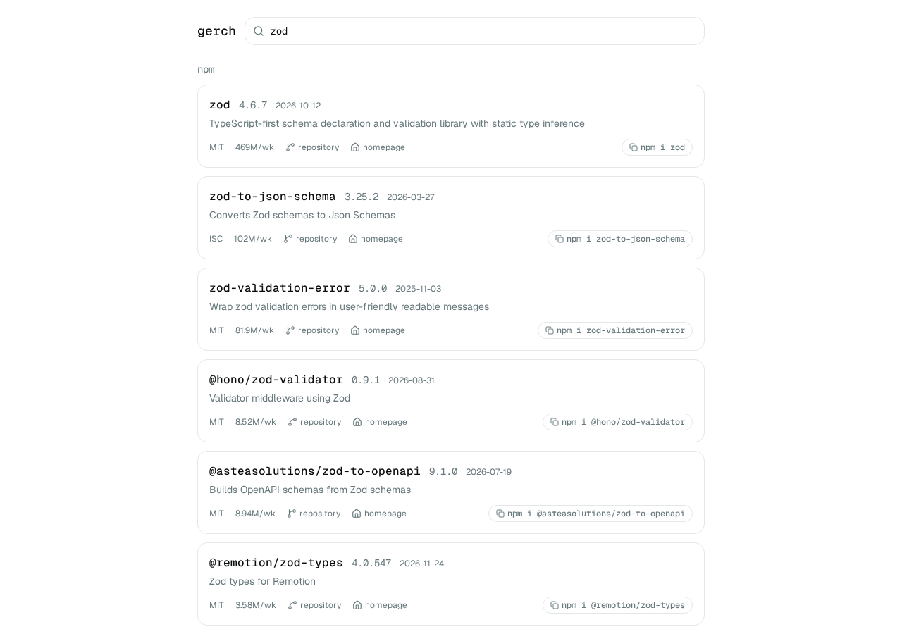

# gerch

One fast, keyboard-first search across **npm**, **crates.io** and **nixpkgs**.
Open results in tabs, pin packages to workspaces, and copy install commands
without leaving the keyboard.

**Live:** [gerch.vkhr.dev](https://gerch.vkhr.dev)



## What it does

- **One box, three registries.** `serde` searches all three; `npm:zod`,
  `crate:serde` and `nix:ripgrep` search one. Each registry streams in its
  own section. A slow or failing registry shows its own error and never
  blocks the others.
- **Cards with what you need:** latest version, release date, license,
  downloads (weekly for npm, 90 days for crates.io), description, links, and
  the install command (`npm i`, `cargo add`, `nix-shell -p`).
- **Tabs and workspaces.** Results open in tabs inside the app. Pinned
  packages go into named workspaces. Tabs, workspaces and search history
  survive reloads.
- **Suggestions** rank pins first, then your history by frecency (a 7-day
  half-life), then live results.
- **Follows your system theme**, light or dark, from the first paint.

### Keyboard

| Keys                           | Action                                 |
| ------------------------------ | -------------------------------------- |
| `/` or `Ctrl+K`                | Focus the search box                   |
| `↓` / `↑`, `Ctrl+N` / `Ctrl+P` | Move through results                   |
| `Enter` / `Shift+Enter`        | Open in this tab / in a new tab        |
| `Alt+C`                        | Copy the install command               |
| `Alt+P` / `Alt+W`              | Pin to a workspace / open workspaces   |
| `Alt+.` / `Alt+,`              | Next or previous tab                   |
| `Alt+Shift+.` / `Alt+Shift+,`  | Move the tab right or left             |
| `Alt+X` / `Alt+Shift+X`        | Close the tab / reopen the last closed |
| `?`                            | All shortcuts                          |

The map avoids shortcuts browsers reserve (Ctrl+T, Ctrl+W, Ctrl+1–9) and
the Alt+letters that open browser menus. Ctrl+N works on macOS and in
installed app windows; on Windows and Linux the browser keeps it for a new
window, so use the arrow keys there.

## How it works

```
browser                               Vercel (one TanStack Start deploy)
  Redact renderer, TanStack     <-SSR-   React DOM server render, streamed
  Router + Query, IndexedDB     --API->  server functions and /api/* routes
  query cache, localStorage                |-> npm registry
  for tabs, pins and history               |-> crates.io, 1 req/s queue
                                           '-> Supabase Postgres:
GitHub Actions, every 6 h  ------------->     shared SWR cache, nix index,
  nixpkgs channel dump                        crates.io queue row, vitals
```

- **TanStack Start** renders pages on the server with React DOM and
  streams each registry's results through its own Suspense boundary. In the
  browser, **Redact** takes over from React DOM: it measured 17–26% faster
  to a usable page and ships 108 kB of JS instead of 146 kB
  ([D34](docs/decisions.md)). React Compiler memoizes the components.
- **A shared cache with stale-while-revalidate**, in Postgres and on
  Vercel's CDN. npm searches stay fresh for 10 minutes and stale for 7 days;
  crates.io packages stay fresh for 6 hours. A stale hit answers at once and
  refreshes in the background.
- **crates.io allows 1 request per second.** Every function instance
  reserves its turn in one Postgres row with an atomic upsert. Search cards
  fill in licenses one at a time, in result order.
- **nixpkgs has no search API.** A scheduled job loads the channel's
  152,000-package dump into Postgres when its ETag changes. Two generated
  `tsvector` columns give prefix search with a ranking tuned on the real
  dump: about 69 MB, 1–80 ms per query.
- **Field vitals** (LCP, INP, CLS, FCP, TTFB) are sampled by route template
  and release. They never include URLs or search text.

The full design, with every trade-off and its measurements, is in
[`docs/spec.md`](docs/spec.md) and [`docs/decisions.md`](docs/decisions.md).

## Performance

Enforced in CI on every PR:

| Budget (Brotli)   | Limit  | Now      |
| ----------------- | ------ | -------- |
| Cold-entry JS     | 150 kB | 108.4 kB |
| Route-specific JS | 50 kB  | 7.3 kB   |
| First-view CSS    | 20 kB  | 6.1 kB   |

Measured with `scripts/measure-renderers.ts` (4× CPU slowdown, fast 4G,
p50 of 9 runs): 685 ms to a usable search page, 98 ms to navigate to a
cached package, 16 ms worst key press while typing.

CI aims at a result in under a minute. Every job has a time budget that
fails it when exceeded: 35 s per job, 15 s of setup, 1 s each for lint and
format. The full suite runs on every PR, the end-to-end flows in four
shards.

## Stack

Bun (a pinned canary) · TanStack Start, Router, Query and Hotkeys ·
React 19 with React Compiler · Redact · Tailwind 4 and Base UI (shadcn) ·
Drizzle on Supabase Postgres (PGlite in tests) · Vercel · Playwright ·
Bun’s built-in `bun lint` and `bun fmt` · hk hooks · Nix dev shell.

## Development

The Nix dev shell provides every tool (`direnv allow`, or
`nix develop`). Then:

```sh
bun ci                  # install
bun run dev             # dev server
bun run verify          # every check, as the pre-push hook runs it
bun x playwright test   # end-to-end flows against the production build
```

Tests never touch the network or a real database: registries answer from
recorded fixtures, and Postgres runs in-process with PGlite. All commands,
conventions and banned patterns are in [`AGENTS.md`](AGENTS.md).

## Data sources

npm's registry and downloads APIs, the crates.io API (within its
[data access policy](https://crates.io/data-access)), and the nixos-unstable
channel dump from channels.nixos.org. Every request identifies itself as
`gerch/<version> (+https://github.com/vk-hr/gerch)`.
